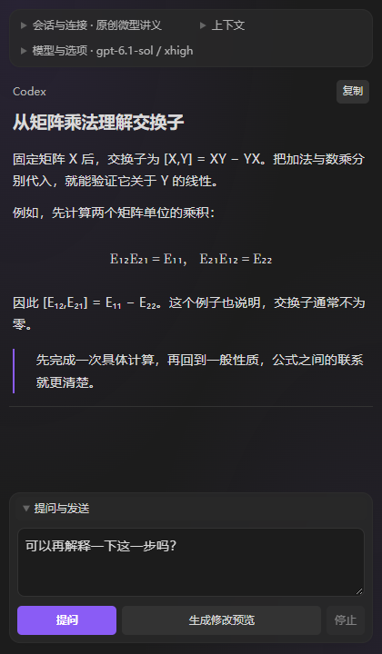

# Codex Sidebar

在 Obsidian 中与 Codex 对话, 随时解释笔记、追问回答, 并通过差异预览审核笔记修改.

使用电脑已有的 Codex 登录. Windows 本地运行隐藏的 Codex CLI, iPad 可连接电脑上的独立远程服务.



## 主要功能

- **笔记伴读**: 捕获编辑选区或当前阅读位置, 解释概念、说明符号、展开推导、检查证明. 上下文保留原 Markdown 和公式.
- **数学与 PDF**: 渲染 Markdown、LaTeX 公式、列表和表格; 支持文字 PDF 选段, 以及扫描 PDF 指定页提问.
- **审核后修改笔记**: 点击“生成修改预览”, 查看目标、原文和拟采用稿, 确认后写入. 支持 AI 自选、严格选区和整篇范围, 并提供冲突检查与安全撤销.
- **回答追问**: 选中回答中的一段继续提问, 可将补充解释融入完整原说明, 方便连接上下文.
- **会话管理**: 随笔记切换对应会话, 保留历史; 返回最近会话时复用已排版的消息并保留阅读位置. 支持编辑已发送的问题、分支重发和确认删除会话, 沿用原始来源快照.
- **行内补全**: 编辑停顿后提出短续写, 在侧栏确认插入. 保留 Obsidian 原生 Tab 和中文输入法行为.
- **模型选择**: 选择实际可用的模型、思考档次与 Fast, 自动保存选择; 按需显示上下文占用和请求状态.
- **磨砂界面**: 顶部工具区与输入区采用局部磨砂, 正文保持清晰. 支持明暗主题、窄栏和独立折叠; 系统要求减少透明效果时使用不透明表面.

## 安装

### Windows

电脑需已安装并登录 Codex CLI, 并在 Codex 中启用 `math-writing` 技能. 插件每轮会显式加载该技能; 安装包不包含技能文件.

**使用 BRAT**: 在 BRAT 中添加仓库 `xsoc1/obsidian-codex-sidebar`, 安装最新正式版, 然后在 Obsidian 的社区插件中启用 Codex Sidebar.

**手动安装**:

1. 从 [Releases](https://github.com/xsoc1/obsidian-codex-sidebar/releases/latest) 下载 `codex-sidebar-版本号.zip`.
2. 将包内文件放入笔记库的 `.obsidian/plugins/codex-sidebar/`.
3. 在 Obsidian 中启用插件. 升级时替换插件文件, 保留已有 `data.json` 和设备缓存.

### iPad

iPad 通过私有 HTTPS 连接 Windows 电脑上的独立 Codex 服务, 电脑需要保持开机和联网. 插件安装后, 在设置中填写远程地址和配对密钥, 点击“保存并连接”.

完整步骤见 [iPad 与 Windows 远程服务指南](docs/ipad-setup.md). iPad 的基础远程问答已有设备验证; 新版外观、分屏及软键盘布局仍需真机确认.

## 开始使用

1. 点击 Obsidian 工具栏上的机器人图标, 打开侧栏.
2. 在“模型与选项”中选择模型和思考档次.
3. 选中笔记文字, 或点击“捕获当前位置”; PDF 可用“选择 PDF 页”指定来源.
4. 输入问题后点击 **提问**, 或按 Enter. Shift+Enter 换行.
5. 需要修改笔记时, 点击 **生成修改预览**, 核对差异后再确认写入.

在回答中选中文字, 可使用“追问这段”. “随笔记切换会话”“修改范围”、补全和工作提示词在插件设置中调整. 四个控制区可分别折叠, 保留草稿和开合状态.

删除历史时, 展开“会话与连接”, 选中会话后点击“删除会话”并确认. 删除不改笔记和修改记录, 其他会话及重发分支保留; 自动关联的当前笔记会话被删除后会使用新的空会话.

## 数据与权限

Codex 后台和读取工具保持只读, 笔记写入由当前 Obsidian 客户端在用户确认后执行. 完整答案遵循最小修补, 解题思路沿原路线展开; 需要重建时先说明并等待用户决定.

插件保存会话与来源快照以支持重连、追问和重发. 桌面与远程会话分开, 远程按配对设备隔离; 配对信息仅存当前设备. 对话和附带的来源会发送给所选 Codex 服务处理.

修改记录独立保存在当前设备, 旧记录自动迁移, 相同原文快照只保存一份. 可在插件设置中导出备份或清除; 清除不改笔记, 但会失去旧提案的采用和安全撤销能力.

## 更多说明

- [笔记修改与安全撤销](docs/note-edits.md)
- [PDF 使用](docs/pdf-support.md)
- [iPad 远程连接](docs/ipad-setup.md)
- [版本更新](https://github.com/xsoc1/obsidian-codex-sidebar/releases)

## 开发

```bash
npm ci
npm run build
npm test
```

构建生成插件文件和独立远程桥. 实现约束及验证方法见 [AGENTS.md](AGENTS.md).
