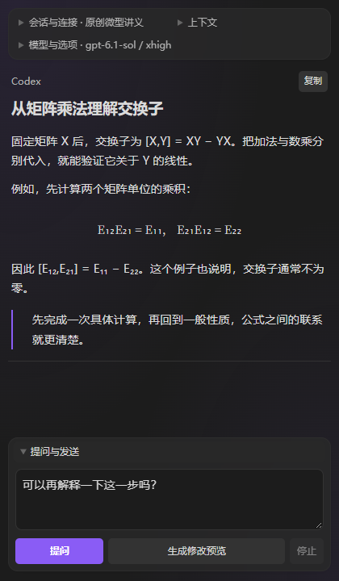

# Codex Sidebar

在 Obsidian 中与 Codex 对话, 随时解释笔记、追问回答, 并通过差异预览审核笔记修改.

从 2.0.0-beta.4 起, iPad 和桌面可以用 API Key 直接连接 OpenAI、DeepSeek、OpenCode Go、Google AI Studio 或 OpenAI 兼容服务. 也可使用原有独立远程桥. Windows 另有后台 Agent 入口. [连接方式与设置](docs/backends.md)

**2.0.0-beta.17** 新增[可调参数图与符号/条件定位](docs/interactive-answers.md): 完整回答后可调参数、核对出处, 带当前状态继续追问. API 直连仍可关联 Obsidian 密钥; iPad 使用 OpenCode Go 时建议选择「原生整段」。[连接设置](docs/backends.md)



## 主要功能

- **笔记伴读**: 捕获编辑选区或当前阅读位置, 解释概念、说明符号、展开推导、检查证明. Agent 可按需搜索整个当前笔记库并补读相关内容, 长文支持分页与版本检查. 上下文保留原 Markdown 和公式.
- **数学与 PDF**: 渲染 Markdown、LaTeX 公式、列表和表格; 支持 PDF 选段、选页和阅读器工具栏的 **Codex 框选**, 松手即附局部图. 整页和局部图每轮合计最多两张.
- **交互解释**: 完整回答可附本地参数图、符号与使用条件; 引用逐字核对原快照后定位来源. 参数按设备保存, 追问先填入草稿, 不自动发送或写笔记.
- **审核后修改笔记**: 点击“生成修改预览”, 查看目标、原文和拟采用稿, 确认后写入. 支持 AI 自选、严格选区和整篇范围, 并提供冲突检查与安全撤销.
- **回答追问**: 选中回答中的一段继续提问, 可将补充解释融入完整原说明, 方便连接上下文.
- **会话管理**: 随笔记切换对应会话, 保留历史; 优先恢复当前会话, 其他正文按需读取, 长会话分段浏览. 问题先保存再提交, 断线后核对原操作. 支持设备本地草稿、编辑问题、分支重发、确认删除与完整会话导出, 沿用原始来源快照.
- **来源回跳**: 回答的链接基准随原问题固定, 来源清单可回到原笔记或 PDF 页; 实际补读范围和 Windows 副本有明确标记. 连续追问可跳回原说明与最新整合回答.
- **行内补全**: 编辑停顿后提出短续写, 在侧栏确认插入. 保留 Obsidian 原生 Tab 和中文输入法行为.
- **模型选择**: 选择实际可用的模型、思考档次与 Fast, 自动保存选择; 按需显示上下文占用和请求状态.
- **磨砂界面**: 顶部工具区与输入区采用局部磨砂, 正文保持清晰. 支持明暗主题、窄栏和独立折叠; 系统要求减少透明效果时使用不透明表面.

## 安装

### Windows

电脑需安装完整的 Codex CLI 运行包, 并在 Codex 中启用 `math-writing` 技能. 插件每轮会显式加载该技能. CLI 路径留空时会查找 PATH 和 Windows 上的 Codex 应用缓存.

在 beta.4 的插件设置中点击 **启动本机 Codex** 即可连接电脑已有的登录. 本机 Codex 也可以用临时 OpenAI API Key 登录. 若要使用其他本机 Agent, 在 **Windows 本机 Agent** 中选择 Claude Code、Antigravity 或 DeepSeek Harness.

`math-writing` 目前是独立私有依赖, 本仓库不提供其下载包, 也不承诺它由 OpenAI 官方供应. 已取得技能的用户按 Codex 支持目录安装启用, 再在插件设置中运行“环境检查”. 获取边界与安装说明见 [开发与依赖](docs/development.md).

**使用 BRAT**: 在 BRAT 中添加仓库 `xsoc1/obsidian-codex-sidebar`, 安装最新正式版, 然后在 Obsidian 的社区插件中启用 Codex Sidebar.

**手动安装**:

1. 从 [Releases](https://github.com/xsoc1/obsidian-codex-sidebar/releases/latest) 下载 `codex-sidebar-版本号.zip`.
2. 将包内文件放入笔记库的 `.obsidian/plugins/codex-sidebar/`.
3. 在 Obsidian 中启用插件. 升级时只替换插件程序, 保留会话、事务日志和设备缓存.

`2.0.0-beta.17` 属于预发布版本，在 BRAT 中需指定此版本。已有 beta.15 独立桥可继续使用；从更早版本迁移及代码回退请参阅 [升级说明](docs/migration.md)。


### iPad

iPad 可在插件设置中选择服务商和模型，填写临时 Key 或通过 **记住 API Key（可选）** 关联 Obsidian 密钥，再点 **启用 API 直连**。直连时电脑可以关机。使用独立远程桥时，在 iPad 填写电脑的私有 HTTPS 地址和配对密钥，点击 **保存并连接**。

完整步骤见 [iPad 与 Windows 远程服务指南](docs/ipad-setup.md). iPad 的基础远程问答已有设备验证; 新版外观、分屏及软键盘布局仍需真机确认.

## 开始使用

在历史材料清单中可查看本轮实际提供和成功补读的范围；从引用跳回原说明后，可点“返回刚才阅读处”。PDF 原文字与补充图片分别导航。收到回答但尚未保存时，可复制正文或重试保存，不会再次请求模型。

1. 点击 Obsidian 工具栏上的机器人图标, 打开侧栏.
2. 在“模型与选项”中选择模型和思考档次.
3. 选中笔记文字, 或点 **上下文 → 捕获当前位置**. PDF 可直接框选, 也可用“选择 PDF 页”指定来源.
4. 输入问题后点击 **提问**, 或按 Enter. Shift+Enter 换行.
5. 需要修改笔记时, 点击 **生成修改预览**, 核对差异后再确认写入.

点 **上下文** 可临时预览来源; 再点一次、点面板外或按 Esc 收起, 不清除已附带的内容. 其他控制区记住开合状态. 在回答中选中文字, 可使用“追问这段”. “随笔记切换会话”“修改范围”、补全和工作提示词在插件设置中调整.

删除历史时, 展开“会话与连接”, 选中会话后点击“删除会话”并确认. 删除不改笔记和修改记录, 其他会话及重发分支保留; 自动关联的当前笔记会话被删除后会使用新的空会话.

设置中的“导出会话”会先补齐远程历史和操作证据, 再生成 JSON 备份. 读取不完整时停止导出. 导出含私人聊天和来源, 请妥善保管; 修改数据库与 PDF 图片使用各自的备份方式.

## 数据与权限

Codex 后台和读取工具保持只读, 笔记写入由当前 Obsidian 客户端在用户确认后执行. 完整答案遵循最小修补, 解题思路沿原路线展开; 需要重建时先说明并等待用户决定.

插件保存会话与来源快照以支持重连、追问和重发. 桌面与远程会话分开, 远程按配对设备隔离; 配对信息仅存当前设备. 对话和附带的来源会发送给所选 Codex 服务处理.

修改记录独立保存在当前设备, 旧记录自动迁移, 相同原文快照只保存一份. 新生成的修改预览及还原缓存在原会话后续完成 1 轮对话后自动清理; 采用或安全还原后重新计时. 可在插件设置中改为保留 N 轮或“永不”, 旧记录不追溯清理. 到期不改聊天与笔记, 但不能再采用或安全撤销对应提案. 支持独立导出备份和手动清除.

## 更多说明

- [笔记修改与安全撤销](docs/note-edits.md)
- [按需读取与修改缓存](docs/vault-reading-and-cache.md)
- [PDF 使用](docs/pdf-support.md)
- [API 直连与 Windows 本机 Agent](docs/backends.md)
- [iPad 远程连接](docs/ipad-setup.md)
- [版本更新](https://github.com/xsoc1/obsidian-codex-sidebar/releases)

## 开发

使用 **Node 24**. 普通分支和 PR 的 CI 覆盖 Ubuntu 与 Windows; 实际执行结果见对应验证记录.

```bash
npm ci
npm run build
npm test
```

构建生成插件文件和独立远程桥. 技能依赖与验证方法见 [开发说明](docs/development.md), 维护约束见 [AGENTS.md](AGENTS.md).
