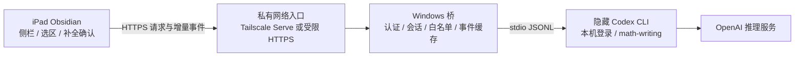

# iPad 支持可行性调研

调研日期: 2026-10-13. 本文件保留迁移前的 0.5.0 基线与当时建议, 下文的“当前代码”均指该基线. 当时只检查源码、官方文档和本机 CLI, 未部署或验收移动功能.

同日后续: 用户要求实现并将 iPad Agent 独立打开隔离, 现已完成 0.6.0 移动入口、独立 Windows 桥和私有 HTTPS 入口. 实际远程对话/补全、客户端断线后继续生成及重连续聊已在 Windows 原生插件验证. 原来的“尚未实现”状态由此更新, iPad 真机验收仍未完成. 最终使用与边界见 [初版指南](ipad-setup.md) 和 [README](../README.md#本机验收). 实施中实测发现临时线程不支持 `thread/read(includeTurns=true)`, 因此改用桥自身事件和文本记录恢复, 不依赖 Cloud resume history.

## 结论与已确定条件

可以开发 iPad 版. 当前插件不能直接安装使用: `manifest.json` 标记 `isDesktopOnly: true`, 且入口及调用链依赖 Node.js、桌面文件系统和本机子进程. 仅修改这个标记会留下加载和运行失败点. Obsidian 官方确认移动环境没有 Node.js/Electron API, 连依赖包中的调用也可能造成插件崩溃. [Obsidian 移动开发](https://docs.obsidian.md/Plugins/Getting%20started/Mobile%20development)

用户已接受 Windows 电脑保持开机、后台提供 Codex 服务. 建议保留 iPad 中原生 Obsidian 的侧栏、选区和编辑器交互, 将 Codex 运行部分迁到 Windows 的独立隐藏桥接进程. Windows 沿用当前用户的本机 Codex 登录; iPad 不接收或复制 OpenAI 登录凭据. 这是一条有源码和协议依据的开发路线, 还不是已经可用的移动版.

## 当前代码的迁移边界

本仓库源码核对如下; 文件链接是本次结论的直接代码依据.

| 部分 | 当前实现 | 移动版处理建议 |
| --- | --- | --- |
| [manifest](../manifest.json) | 桌面限定 | 移除移动入口的桌面依赖后才改为支持移动 |
| [主入口](../src/main.ts) | 顶层导入 `node:fs`、`node:crypto`、`node:child_process`、`node:path`; 使用 `where.exe`、`FileSystemAdapter.getBasePath()` | CLI 发现、绝对工作目录、文件检查和运行期指令构造留在 Windows; 移动入口不得静态加载这些模块 |
| [RPC](../src/rpc.ts) | 隐藏 `spawn` 子进程, stdin/stdout JSONL, `StringDecoder` | 移到 Windows 桥; iPad 使用独立 HTTP 客户端 |
| [补全服务](../src/completion.ts) | 每次补全启动单独隐藏 CLI, 临时只读线程、JSON 输出 | 放到 Windows; iPad 发送前后文, 在本机检验建议是否过期并确认插入 |
| [技能](../src/skills.ts) | `node:path` 检查绝对技能路径; 主入口还做本机存在性检查 | 在 Windows 发现和验证 math-writing; iPad 只接收就绪状态 |
| [笔记捕获](../src/context.ts) | Obsidian Editor、阅读渲染块、`getViewData`/`cachedRead` 和 DOM 选区 | 有复用基础; 移动阅读选区、触控和公式选区另做真机验证 |
| [行内交互](../src/inline.ts) | CodeMirror 扩展、IME/光标失效检查、侧栏确认 | 有复用基础; 保留原生 Tab, 触控键盘/中文输入验收后开放 |
| [引用](../src/quote.ts)、[历史](../src/history.ts)、[选项](../src/controls.ts) | 选中回答快照、分支重发、明确保存的模型选择 | 大部分是平台无关逻辑; 保留不可变引用和原会话 |
| [只读工具](../src/obsidian-tool.ts) | 固定 vault 和命令/参数白名单, 通过宿主 CLI 调用 | 保持受限接口, 不做任意 shell/RPC 转发. 调用 Windows Obsidian CLI 的功能还需要 Windows Obsidian 可用 |

入口计划继续采用工具栏按钮并提供 Obsidian 命令, 但 iPad 的具体入口位置、侧栏展开方式、分屏和软键盘占位需要适配和实测. 移动版应继续保存具体模型、思考档次和开关选择, 不重新引入默认模型配置或悬停说明.

## Codex 后端: 本次核实了什么

本机 CLI 为 `codex-cli 0.162.0-alpha.17.2`. 只执行了 `--version`、`app-server --help`、`app-server generate-ts --help` 与将协议生成到仓库外临时目录; 没有运行 App Server. 下列是本机帮助与生成类型的实际结果, 不把文档最新版当作已安装版本的保证.

- 帮助列出的监听协议为 `stdio://`、`unix://`、`unix://PATH`、`ws://IP:PORT` 和 `off`, 没有直接的 `--listen wss://`.
- 同一帮助支持 `--ws-auth capability-token` / `signed-bearer-token`, `--ws-token-file` / `--ws-token-sha256` / `--ws-shared-secret-file`, 以及 issuer、audience 和时钟偏差参数.
- 生成的 `ThreadStartParams` 有 `ephemeral`、`dynamicTools`、工作目录与权限字段; `ThreadInjectItemsParams` 可追加模型历史; `UserInput` 有 `skill` 输入; `SkillsListParams` 有 `cwds` 和 `forceReload`.
- `ThreadResumeParams.history` 明确标记 `[UNSTABLE] FOR CODEX CLOUD - DO NOT USE`. 移动重连不应依赖这个字段.
- 当前插件代码已经使用 `ephemeral: true` + 本地问答快照 + `thread/inject_items`, 并为每次聊天/补全附上 math-writing 输入. 这些是现有桌面实现事实, 不是移动验收结果.

官方 App Server 文档将 WebSocket 传输标为实验且不受支持, 提醒非回环监听默认可接受无认证连接, 并要求在远程开放前配置传输认证. 它的 bearer 凭据在握手时提交. 因此即使已有 WebSocket 参数, 也不应把原始 App Server 直接暴露到网络. [OpenAI 官方 App Server 文档](https://learn.chatgpt.com/docs/app-server#protocol)

官方 CLI 安装文档提供 macOS、Linux、Windows 等入口, 没有查到在 iPad Obsidian 插件内原生启动 CLI 的官方安装路线. 这不排除第三方远程终端等方案, 但它们不能为本插件提供移动环境缺少的 Node 子进程能力. [OpenAI 官方 Codex CLI 文档](https://learn.chatgpt.com/docs/cli)

## 推荐架构与网络传输

建议首版用 HTTPS 提交问题和控制请求, 按事件 cursor 增量轮询回答. Obsidian 的 `requestUrl` 官方接口支持 HTTP/HTTPS 且没有 CORS 限制; 本仓库安装的 `obsidian.d.ts` 提供请求 headers, 返回完整 `arrayBuffer`/`json`/`text`, 没有公开流式 reader. 轮询是根据接口形态作出的工程选择, 不能据此断言 iPad 上 `fetch` 或 WebSocket 都不可用. [Obsidian requestUrl](https://docs.obsidian.md/Reference/TypeScript%20API/requestUrl)

桥可设计 `submit`、`events(afterCursor)`、`interrupt`、`completion`、`answerApproval` 等受限业务接口; 提交携带唯一请求 ID, 避免网络超时重试创建两次 turn. 事件含顺序号, 缓存有大小/期限边界, 超出窗口时返回会话快照. 模型列表、思考状态、Fast、上下文占用及完成/中断状态均从 Windows 实际后端结果传回. 这些是建议协议, 本次没有实现或压测.

WSS 可作为后续优化. 标准浏览器 `WebSocket(url, protocols)` 没有任意请求头参数, 而上述 App Server 认证要求握手 `Authorization: Bearer`. 由此可推断, 移动前端直接使用标准 WebSocket 连接受认证 App Server 有接口错配; 需桥端改用独立配对认证、受限会话票据或受信代理, 不能假定在 iPad 构造器里加 headers 就能解决. 不将凭据放进可被记录的 URL. [WHATWG WebSockets 标准](https://websockets.spec.whatwg.org/#the-websocket-interface)

建议私有连接采用 iPad/Windows 同一 tailnet, Windows 桥只监听 localhost, Tailscale Serve 提供私有 HTTPS 并应用访问规则. 如果使用其身份头, 桥只信任本机受信代理入口, 仍按用户/设备限定 vault 与操作. Tailscale 官方支持 iPad; Serve 的官方定义是对 tailnet 提供服务, 公网 Funnel 是另一种模式. 本次没有检查或改动用户既有路由, 也未验证本机设备间连通性. [Tailscale iOS/iPad 安装](https://tailscale.com/docs/install/ios), [Serve 与身份头](https://tailscale.com/docs/features/tailscale-serve)

## 登录、会话和技能的位置

Windows 桥以当前登录用户身份启动独立、可关闭的 CLI, 使用既有登录缓存. 官方确认 CLI 会缓存并复用登录; ChatGPT 登录与 API key 是不同认证/计费路线. iPad 只保存桥的连接和配对信息, 不解析或搬运 Codex 私有认证文件, 不接管桌面应用私有 socket, 不向移动客户端提供登录/退出、全局配置写入或任意命令 RPC. [OpenAI 官方认证文档](https://learn.chatgpt.com/docs/auth#login-caching)

桥的配对令牌应按设备单独管理、可撤销, 与会跨设备同步的共同插件设置分开保存. 本次没有选定或验证 iPad 上的凭据存储实现.

保留后台隐式会话需要继续使用 ephemeral 运行线程. 长期可见问答由插件/桥自己的记录恢复, 不能把 ephemeral 线程 ID 当作跨进程永久 ID. 桥重启后新建临时线程并注入已保存问答; 保留选区源快照与引用, 不声称恢复了完整工具运行状态. 如果桌面与 iPad 要续同一会话, 建议 Windows 桥成为唯一会话写入方, 以稳定应用会话 ID 管理运行线程; 两端保存各自 UI/选择状态. 不靠同步两个 `data.json` 的覆盖顺序来实现并发会话.

math-writing 的发现、启用检查、绝对路径及执行发生在 Windows; iPad 不需要安装同一技能文件. 应沿用每次请求的显式 `skill` 输入和固定数学修改准则. 对外只暴露可用状态, 不接受 iPad 自由指定 Windows 工作目录、技能路径或系统配置. 此建议依据本机生成协议和 [现有技能加载代码](../src/skills.ts); 远程桥仍须实际抓取 `turn/start` 验证技能确已携带.

Windows 桥保持只读沙箱, 固定 vault, 校验输入长度和路径; 仅对桥创建的会话接受请求, 审批只响应仍有效的原请求. 当前只读 Obsidian 工具不能变成通用远程 shell. iPad 离线时, 若任务需要移动端工具或人工审批, 应明确进入等待/失败/超时状态, 不默认批准.

## 选区、阅读内容与同步

iPad 看到的笔记、未保存编辑和选区, 应由 iPad 自己捕获源文本/快照再随问题发送. 这使基础问答不必等待整库同步. Windows 从磁盘或 Windows Obsidian 读取的则是 Windows 副本, 可能落后于 iPad; 应标明来源并比较版本, 不把同名路径当成相同内容. 回答引用继续包含渲染选区和捕获时的原回答 Markdown, 不声称精确字符映射.

行内补全只返回建议, 在 iPad 检查文件、文档版本、光标和 IME 状态后由侧栏确认. 电脑端不直接把补全文本写入同步目录, 避免和 iPad 草稿冲突. 保留完整答案最小改动、思路严格沿原路线、重大重建交用户决定和模仿用户写法等规则. PDF 页面、截图/OCR等原本未实现的功能, 不因加入远程桥就变为已支持.

## iPad 后台与验收边界

Apple 说明应用进入后台后通常会被挂起, 特殊后台能力由宿主应用声明. 因而不能以插件长连接一直存活为前提. 建议任务由 Windows 继续执行, iPad 回到前台后按 cursor 拉取事件并核对状态, 已失效的补全不再插入. 这仍需 Obsidian 真机生命周期测试. [Apple 后台执行说明](https://developer.apple.com/documentation/xcode/configuring-background-execution-modes)

首个可接受版本需要以下真实验证, 桌面移动模拟和构建成功不能替代:

1. iPad 安装加载、左侧入口、侧栏展开、分屏和软键盘遮挡; 所有移动入口无 Node/Electron 模块加载.
2. 同 Wi-Fi 与外网私有连接, 错误配对拒绝、过期凭据拒绝、电脑关机明确显示离线; 不开放未认证原始 RPC.
3. 实际模型问答、中文/MathJax 排版、思考指示、模型/档次/Fast/占用状态和选择保存; 实际 `turn/start` 的选择及技能与界面一致.
4. 触控选择笔记与回答、公式选区、引用取消、编辑/重发、原会话保持; 使用 iPad 未同步稿证明上下文来自移动端快照.
5. 中文 IME、手写/外接键盘、Tab 保持原生、过期结果拒绝和一次确认只插入一次; 先测试手动补全, 再开放自动请求.
6. 切后台/锁屏/网络切换后补回事件, 重复提交去重, Windows 桥重启后的问答恢复, 两端同会话并发边界与审批超时.

Obsidian 官方给出的 iOS WebView 检查流程要求 iOS 16.4+ 与 macOS 电脑. 若没有这组调试设备, 仍可做用户可见操作与日志验收, 但不能声称已完成该原生 Inspector 检查. [Obsidian 真机检查说明](https://docs.obsidian.md/Plugins/Getting%20started/Mobile%20development)

## 其他路线与下一步

使用独立 API key 的远程模型服务也是技术路线, 但按 API 平台用量计费, 不等于复用当前 Windows Codex 登录与隐式 CLI. 本次优先方案不需要用户先改成 API key. 若未来希望 Windows 完全离线时也工作, 再单独确定远程运行环境、登录能力、费用、技能和 vault 数据边界. [OpenAI 官方认证与计费区别](https://learn.chatgpt.com/docs/auth#sign-in-with-an-api-key)

建议实施顺序: 抽离跨平台 UI 与传输接口; 建立 Windows 只读私有桥和会话 owner; iPad 首轮问答/引用/手动补全真机验收; 再添加自动补全与可选 WSS. 本次只保存调研文档, 没有部署服务或修改已安装插件、凭据、同步配置、网络路由.
